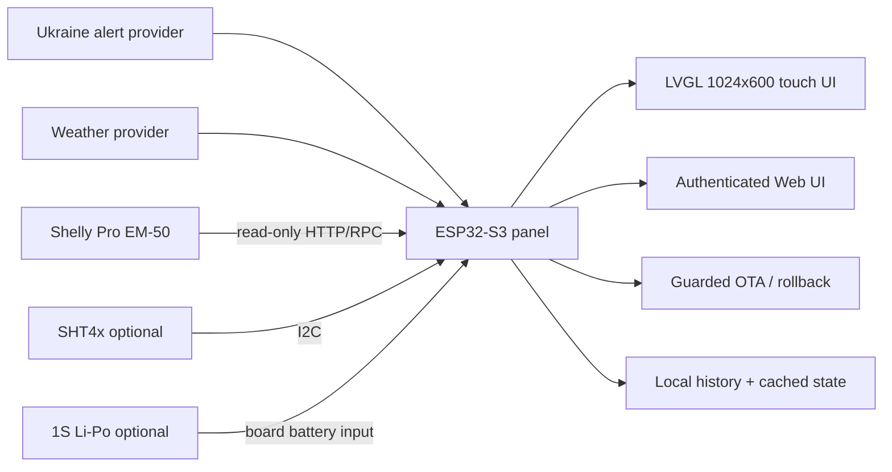

<p align="center">
  <a href="README_EN.md"></a>
  <a href="README_RU.md"></a>
  <a href="README_UA.md"></a>
</p>

<h1 align="center">🇺🇦 Ukraine Status Panel</h1>
<p align="center"><strong>A local-first 7-inch ESP32-S3 dashboard for Ukraine alerts, weather, power and home status.</strong></p>
<p align="center">Waveshare ESP32-S3-Touch-LCD-7B · ESPHome · LVGL · Touch UI · Shelly Pro EM-50 · Optional SHT4x · Spotify</p>

<p align="center">
  
  
  
  <a href="LICENSE"></a>
</p>

---

## Overview

**Ukraine Status Panel** turns the Waveshare ESP32-S3-Touch-LCD-7B into an always-on local information display. It combines Ukraine alert data, weather, household power information, room/environment data and media controls in one touch-first interface.

The firmware is designed to keep useful local UI available when external services are slow or temporarily unavailable. Hardware-facing integrations are intentionally conservative: Shelly Pro EM-50 is read-only, optional sensors are non-blocking, and physical LCD claims require validation on the real panel.

<table>
<tr><td>🚨 <b>Ukraine alert map</b></td><td>🌦️ Weather and forecast</td></tr>
<tr><td>⚡ <b>Shelly Pro EM-50</b></td><td>🔋 Battery voltage and status UI</td></tr>
<tr><td>🌡️ <b>Optional SHT4x</b></td><td>📈 Room and outage history</td></tr>
<tr><td>🎵 <b>Spotify controls</b></td><td>🖥️ Native LVGL touch interface</td></tr>
<tr><td>🌐 <b>Authenticated Web UI</b></td><td>🔄 Guarded OTA and rollback policy</td></tr>
</table>

## Hardware

Reference target:

- **Waveshare ESP32-S3-Touch-LCD-7B**
- 7-inch capacitive touch display, **1024×600**
- ESP32-S3, **16 MB Flash**, **8 MB PSRAM**
- Optional **1S 3.7 V Li-Po** through the board battery connector
- Optional **SHT41/SHT45** over the shared I²C expansion path
- Optional passive buzzer module
- Optional **Shelly Pro EM-50** on the LAN for read-only voltage/power monitoring

## Main screens

`Overview` · `Map` · `Weather` · `Power` · `History` · `Spotify` · `Clock` · `Settings`

The interface is designed for direct touch use on the 1024×600 panel. Full-screen map/weather modes, localized labels and persistent top-level status indicators are part of the firmware rather than a remote browser dashboard.

## Architecture



## Development status

This repository is in **active hardware development**. The public tree is prepared from a cleaned project snapshot: local deployment addresses, secrets, private checkpoints, UART logs and build artifacts are intentionally excluded.

Release policy is fail-closed:

1. static/native tests;
2. real LVGL host rendering where applicable;
3. ESPHome configuration and generated-code validation;
4. Xtensa syntax validation;
5. full software/browser regression;
6. release-integrity checks;
7. one guarded production build and OTA attempt;
8. machine qualification on the physical panel;
9. human confirmation for visible LCD changes.

## Quick start

The project currently targets developers and hardware testers. The public first-flash YAML is a USB provisioning profile **without embedded Wi-Fi credentials or `!secret` references**:

```bash
git clone https://github.com/iSentinel/ukraine-status-panel.git
cd ukraine-status-panel
esphome config firmware/ukraine-status-panel-public-first-flash.yaml
```

Use the pinned ESPHome toolchain specified by the project. No `secrets.yaml` is required for the public configuration check. For a separate **private** profile, copy `secrets.example.yaml` to `firmware/secrets.yaml` and replace its placeholders; never commit that file. The public factory image and Web Installer remain `validation-required` until an exact-version USB first-flash is accepted on spare hardware. **Do not flash a working panel simply to follow these steps.** See [Web Installer guidance](web-installer/README.md).

For ordinary development, see the scripts and CI checks in the repository before building a production image.

## Privacy and safety

- Secrets are never committed.
- Local deployment IP addresses are not part of the public defaults.
- Shelly integration is **read-only**; the panel does not switch electrical loads.
- Browser OTA is intentionally restricted by the firmware policy.
- Optional hardware must not prevent the main dashboard from booting.

## Documentation

- 🇬🇧 [English](README_EN.md)
- 🇷🇺 [Русский](README_RU.md)
- 🇺🇦 [Українська](README_UA.md)
- 🧭 [Roadmap](ROADMAP.md)
- 📝 [Changelog](CHANGELOG.md)
- 🤝 [Contributing](CONTRIBUTING.md)

---

<p align="center"><strong>Alerts. Weather. Power. Home status. One local panel.</strong></p>
